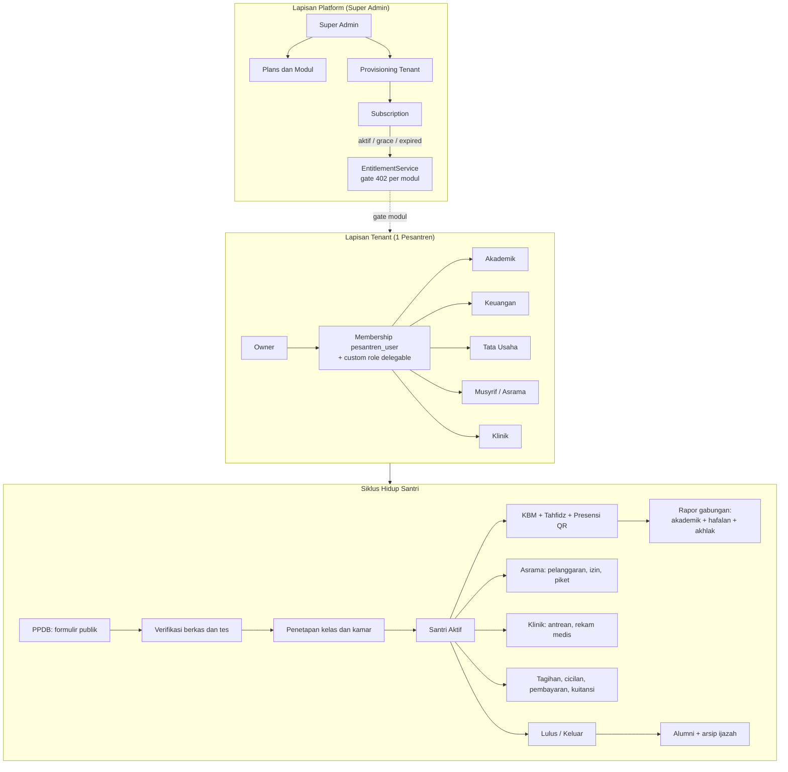
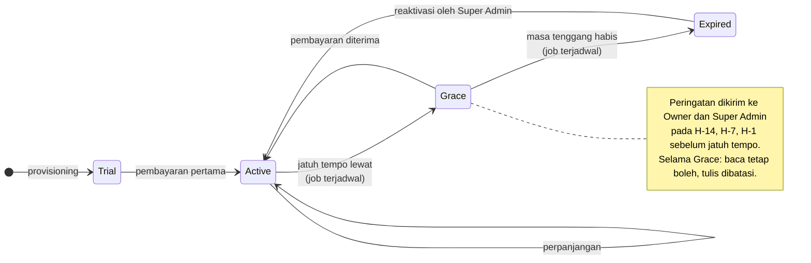
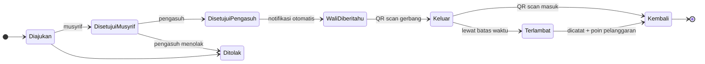
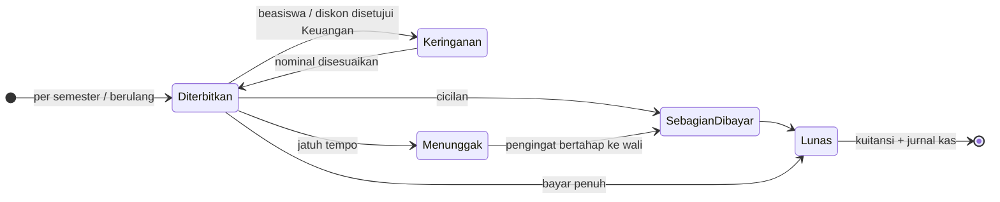
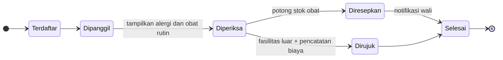
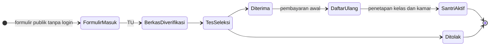
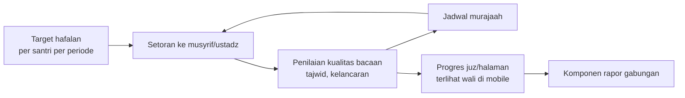
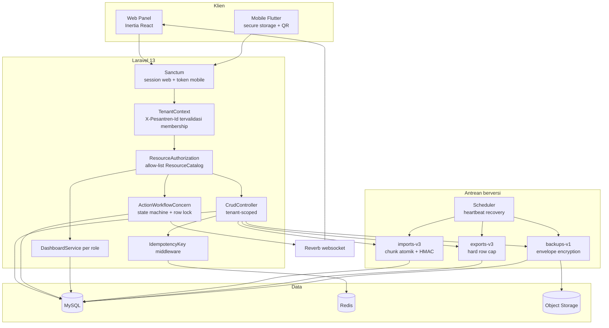

# Peta Business Logic Pesantrenku

Dokumen ini adalah sumber tunggal untuk memahami model bisnis, aktor, alur uang,
dan workflow domain Pesantrenku. Diagram memakai Mermaid agar dirender langsung
di GitLab dan mudah diperbarui bersama kode.

Rujukan implementasi: `app/Services/EntitlementService.php`,
`app/Http/Controllers/Concerns/ActionWorkflowConcern.php`,
`app/Services/DashboardService.php`, `docs/architecture.md`, dan backlog di
`docs/backlog/improvement-backlog.md`.

## 1. Dua lapisan bisnis

Ada dua lapisan uang dan dua lapisan aktor yang tidak boleh tercampur:

| Lapisan | Aktor | Sumber uang | Objek utama |
|---|---|---|---|
| Platform (B2B SaaS) | Super Admin | Langganan pesantren | `plans`, `subscriptions`, tenant modules |
| Tenant (operasional) | Owner, Keuangan, Akademik, TU, Musyrif, Klinik, Wali, Santri | Tagihan santri | `invoices`, `payments`, resource domain |

Role efektif selalu berasal dari membership `pesantren_user` pada tenant aktif
(`TenantContext`), bukan role global. Entitlement modul dievaluasi
`EntitlementService` dan menolak dengan 402 bila modul tidak termasuk paket.

## 2. Siklus hidup langganan tenant

Status langganan yang seharusnya, termasuk masa tenggang agar tenant tidak
terkunci mendadak di tengah semester. Transisi `active -> grace -> expired`
harus dijalankan job terjadwal, bukan manual (backlog #68-70).

## 3. Workflow domain (state machine)

Semua workflow di bawah memakai state transition khusus, row lock, audit, dan
idempotency (`ActionWorkflowConcern`). Diagram menunjukkan alur yang seharusnya,
termasuk tahap yang belum diimplementasikan (perizinan berjenjang, backlog #206).

### 3.1 Perizinan santri (berjenjang)

### 3.2 Tagihan dan pembayaran santri

Aturan uang: nominal disimpan sebagai integer satuan terkecil (rupiah penuh),
bukan float. Setiap mutasi pembayaran wajib `Idempotency-Key`.

### 3.3 Antrean klinik

Catatan UU PDP: data kesehatan santri adalah data pribadi spesifik. Kontrol
akses dan audit untuk resource medis harus terpisah dari data akademik
(backlog #27).

### 3.4 PPDB (pendaftaran santri baru) - modul baru

### 3.5 Tahfidz - modul baru

## 4. Alur sistem teknis

## 5. Kesenjangan logika bisnis (per 2026-08-09)

Dipetakan terhadap backlog `docs/backlog/improvement-backlog.md`:

1. **Subscription lifecycle belum otomatis** - tidak ada job `expired`, masa
   tenggang, atau peringatan pra-kedaluwarsa (#68-70). Risiko: tenant terkunci
   mendadak. Prioritas tertinggi.
2. **Keuangan santri belum siklus utuh** - belum ada tagihan berulang,
   keringanan, cicilan, virtual account (#210-212); `payments` masih generik (#88).
3. **Tahfidz dan PPDB belum ada** (#201-202) - pembeda utama produk pesantren.
4. **Perizinan belum berjenjang** dan presensi QR belum mencakup salat
   berjamaah (#205-206).
5. **Kalender akademik belum jadi sumber tunggal penjadwalan** (#223).
6. **Pencabutan akses tertunda 30 detik** karena cache membership (#7).

## 6. Urutan eksekusi yang disepakati

1. Fondasi: sisa P0 (#87 pecah CrudController, #134 proteksi branch main,
   #143 pecah App.jsx, #65/#228 bukti staging).
2. Otomasi subscription lifecycle (bagian 2 dokumen ini).
3. Modul domain: Tahfidz, PPDB, keuangan siklus penuh, perizinan berjenjang.
4. Lapisan UI/UX: lihat `docs/ui/redesign-spec.md`.
